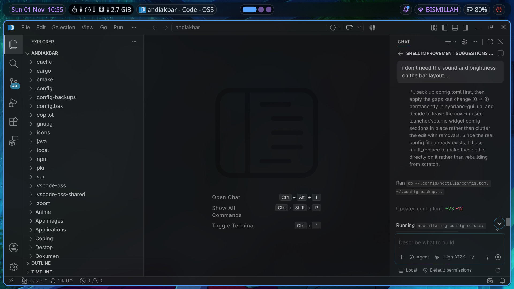
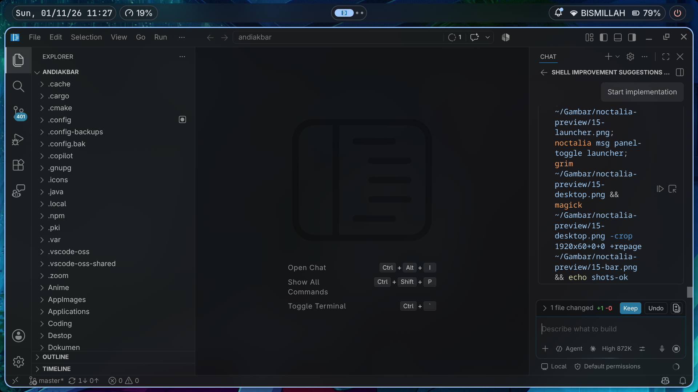
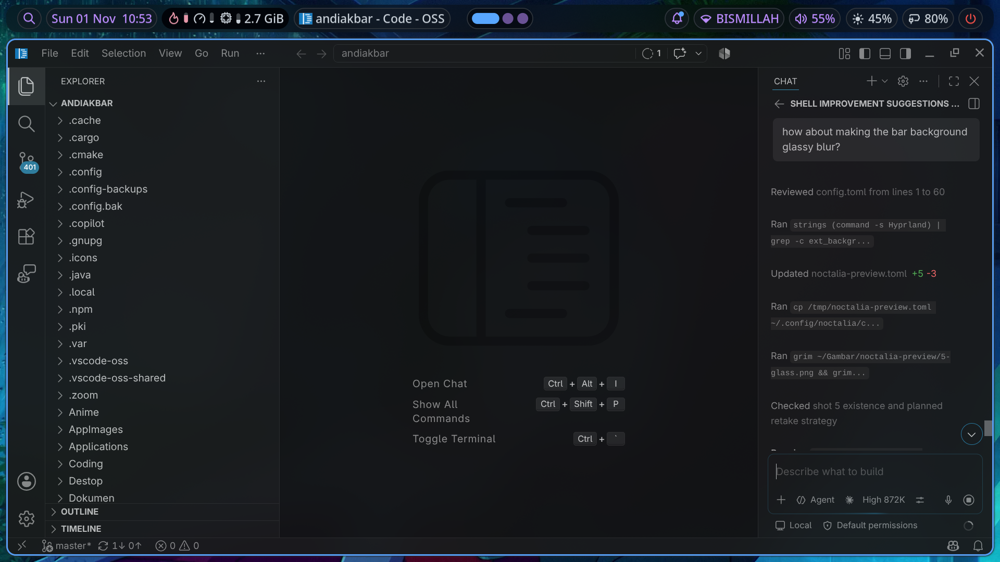
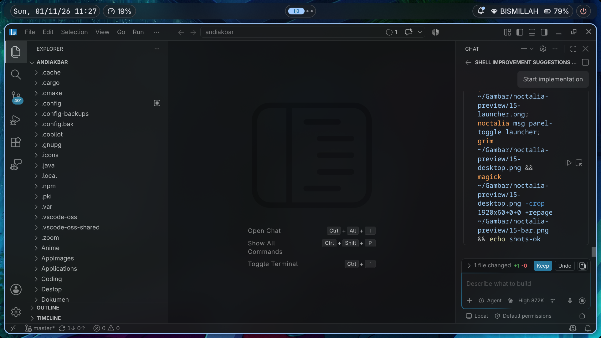
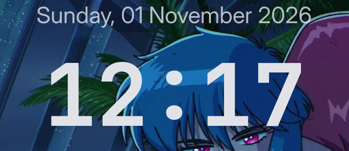

# tonal-dots

Hyprland 0.57 (Lua config) + [Noctalia](https://github.com/noctalia-dev/noctalia) v5 shell, themed with Material 3 *tonal spot* colors generated from the wallpaper.



## Features

- **Modular Lua Hyprland config**: one file per concern under `config/hypr/config/`, all loaded from `hyprland.lua`.
- **Auto picture-in-picture**: when you leave a workspace with a playing video, it shrinks into a pinned PiP window that follows you, and goes back when you return. Firefox uses its own PiP. Toggle with <kbd>SUPER</kbd> + <kbd>SHIFT</kbd> + <kbd>P</kbd>.
- **Glass Noctalia bar and panels**: capsule bar, rounded screen corners, launcher with pinned apps, satty for screenshots/clipboard images.
- **Desk Clock plugin** (`andiakbar/deskclock`): a desktop clock that shows icons of apps with unread notifications. The bar's left side switches between clock and stats depending on whether a window covers the desktop clock.
- **Wallpaper-driven colors**: Noctalia generates matching themes for Hyprland, kitty, alacritty and btop.
- Battery warning hook (20% / 10%), fish + starship prompt, foot/alacritty/kitty terminals.

## Screenshots

| Launcher | Control center |
| --- | --- |
|  |  |
| **Desktop** | **Desk clock** |
|  |  |

## Requirements

Built on CachyOS (Arch). Package names are for Arch; adjust for your distro.

| Purpose | Packages |
| --- | --- |
| Compositor and session | `hyprland` (>= 0.57, Lua config), `uwsm`, `xdg-desktop-portal-hyprland` |
| Shell | `noctalia` (>= 5.4), `socat`, `dbus` (`dbus-monitor`, for the Desk Clock plugin) |
| Auto-PiP | `systemd` (`busctl`) |
| Utilities | `satty`, `hyprpicker`, `libnotify` (`notify-send`) |
| Terminal / CLI | `kitty`, `foot`, `alacritty`, `fish`, `starship`, `fzf`, `fd`, `zoxide`, `direnv`, `btop`, `neovim`, `fastfetch` |
| Fonts | `ttf-jetbrains-mono-nerd`, Adwaita Sans (`adwaita-fonts`) |
| Default apps (editable) | `dolphin`, `firefox`, `gnome-text-editor`, `gnome-calculator` |

## Install

```sh
git clone https://github.com/andiakbararyaputra/tonal-dots.git ~/tonal-dots
cd ~/tonal-dots
./install.sh --dry-run   # preview
./install.sh             # install everything
```

`install.sh` symlinks each folder into `~/.config` (and the plugin into `~/.local/share/noctalia/plugins`). Anything already there is moved to `~/.config/tonal-dots-backup-<timestamp>/`. It never uses sudo or installs packages.

Install only some parts:

```sh
./install.sh --list
./install.sh --only hypr noctalia deskclock
```

Then reload Hyprland (`hyprctl reload`) and restart Noctalia, or log out and back in.

### Uninstall

Remove the symlinks and move your backup back, for example:

```sh
rm ~/.config/hypr
mv ~/.config/tonal-dots-backup-<timestamp>/hypr ~/.config/hypr
```

## Structure

```
tonal-dots/
├── install.sh
├── config/
│   ├── hypr/              # Hyprland Lua config
│   │   ├── hyprland.lua   # entry point
│   │   ├── hyprland-gui.lua  # managed by HyprMod
│   │   ├── noctalia.lua   # generated colors
│   │   ├── config/        # animations, autopip, autostart, binds, monitors, ...
│   │   └── scripts/mpris-playing.sh
│   ├── noctalia/          # config.toml + hooks/
│   ├── kitty/ foot/ alacritty/
│   ├── fish/ starship.toml
│   └── btop/ nvim/ fastfetch/
├── local/share/noctalia/plugins/deskclock/
└── assets/screenshots/
```

## Keybinds

<kbd>SUPER</kbd> is the main modifier.

| Keys | Action |
| --- | --- |
| `SUPER + Return` | Terminal (kitty) |
| `SUPER + Space` | Launcher |
| `SUPER + period` | Emoji picker |
| `SUPER + W` / `E` / `T` / `C` | Browser / file manager / editor / calculator |
| `SUPER + Q` | Close window |
| `SUPER + Escape` | Kill window (click to select) |
| `SUPER + F` / `D` | Fullscreen / maximize |
| `SUPER + ALT + Space` | Toggle floating |
| `SUPER + J` | Toggle split |
| `SUPER + Arrows` | Move focus |
| `SUPER + SHIFT + Arrows` | Move window |
| `SUPER + 1..0` | Go to workspace |
| `SUPER + SHIFT + 1..0` | Move window to workspace |
| `SUPER + CTRL + Left/Right` | Previous / next workspace |
| `SUPER + CTRL + Down` | Next empty workspace |
| `SUPER + S` / `SUPER + SHIFT + S` | Toggle scratchpad / move window there |
| `SUPER + SHIFT + P` | Toggle auto-PiP window |
| `SUPER + Tab` / `ALT + Tab` | Window switcher / cycle windows |
| `SUPER + X` | Control center |
| `SUPER + A` | Notifications |
| `SUPER + V` | Clipboard history |
| `SUPER + SHIFT + W` | Wallpaper picker |
| `SUPER + Z` | Noctalia settings |
| `SUPER + L` | Lock |
| `SUPER + ALT + C` | Session menu |
| `Print` / `SUPER + Print` | Region / fullscreen screenshot |
| `SUPER + P` | Color picker |
| `SUPER + Plus` / `Minus` | Zoom in / out |
| `CTRL + SHIFT + Escape` | btop |

## Customization

- **Default apps**: edit `config/hypr/config/variables.lua` (`TERMINAL`, `BROWSER`, ...).
- **Monitors**: set `MONITOR1..3` in `variables.lua` and the layout in `config/hypr/config/monitors.lua` (`hyprctl monitors` lists names).
- **Without UWSM**: set `launchPrefix = ""` in `binds.lua` and drop the `uwsm app --` prefix in `autostart.lua`.
- **Generated theme files**: `hypr/noctalia.lua`, `kitty/themes/noctalia.conf`, `alacritty/themes/noctalia.toml` and `btop/themes/noctalia.theme` are snapshots. Noctalia rewrites them when the wallpaper changes, so they show up as changes in git.
- **Suspend on idle**: the idle action in `noctalia/config.toml` reads `/sys/class/power_supply/ADP1/online`. Change `ADP1` to match your laptop, or remove the action.
- **Lock screen / desktop widgets**: `[lockscreen_widgets]` and `[desktop_widgets]` in `noctalia/config.toml` are laid out for `eDP-1` (1280x720) and `HDMI-A-2` (3840x2160). Change `output`, `cx`/`cy` and box sizes to match your monitors. A `[lockscreen_widgets]` block in `~/.local/state/noctalia/settings.toml` (written by the Settings editor) overrides this one.

## Credits

- [Hyprland](https://hyprland.org)
- [Noctalia](https://github.com/noctalia-dev/noctalia)
- [cachyos-hypr-noctalia](https://github.com/cachyos/cachyos-hypr-noctalia), the base for the Hyprland config

## License

Original work in this repo (install script, auto-PiP, Desk Clock plugin, hooks, scripts) is released under the [MIT License](LICENSE). Files based on [cachyos-hypr-noctalia](https://github.com/cachyos/cachyos-hypr-noctalia) keep that project's license (GPL, as packaged by CachyOS).
